<div align="center">


# VERIS

### Sovereign On-Premise AI Platform for Indonesian PII Detection, Statutory De-Identification & Pre-LLM Privacy Gateway

**Engineered for Undang-Undang Nomor 27 Tahun 2022 tentang Pelindungan Data Pribadi (UU PDP)**

[](#)
[](https://peraturan.bpk.go.id/Details/229798/uu-no-27-tahun-2022)
[](#5-benchmark-empiris--evaluasi-ilmiah)
[](#5-benchmark-empiris--evaluasi-ilmiah)
[-1d4ed8?style=for-the-badge)](#2-mengapa-veris-dibangun)

[](https://www.python.org/)
[](https://fastapi.tiangolo.com/)
[-EE4C2C?style=flat-square&logo=pytorch&logoColor=white)](https://pytorch.org/)
[-000000?style=flat-square&logo=next.js&logoColor=white)](https://nextjs.org/)
[](https://www.typescriptlang.org/)
[](https://www.docker.com/)

---

[**Ringkasan Eksekutif**](#1-ringkasan-eksekutif) •
[**Tampilan Antarmuka (UI)**](#3-tampilan-antarmuka-web-veris-web-console) •
[**Arsitektur Hibrida**](#4-arsitektur-sistem--pipeline-hibrida-4-tahap) •
[**Taksonomi UU PDP**](#5-cakupan-10-entitas-pii--pemetaan-regulasi-uu-pdp) •
[**Hasil Benchmark**](#6-benchmark-empiris--evaluasi-ilmiah) •
[**Pre-LLM Gateway**](#8-pre-llm-privacy-gateway--ai-security-guardrail) •
[**Spesifikasi API**](#9-referensi-rest-api-v1)

</div>

---

> [!IMPORTANT]
> **🔒 Intellectual Property & Public Showcase Notice**  
> Untuk menjaga keamanan sistem dan melindungi Kekayaan Intelektual (*Intellectual Property*), repositori publik ini berfungsi sebagai **Official Architecture, Benchmark & Product Showcase** untuk **Veris**.  
> Kode sumber mesin inferensi inti (`veris-backend`, algoritma *Statutory Checksum Validator*, *Hybrid Span Arbiter*) beserta bobot model terlatih (`model.safetensors`) dikelola di dalam **repositori privat**. Akses *sandbox*, demonstrasi teknis, atau kolaborasi *enterprise* dapat diajukan melalui pemilik repositori ([Lihat Lisensi & Ketentuan](LICENSE)).

---

## 1. Ringkasan Eksekutif

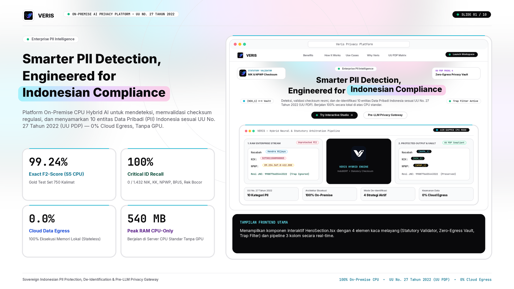

**Veris** adalah platform kecerdasan buatan *on-premise* berarsitektur *stateless microservice* yang dirancang khusus untuk mendeteksi, memvalidasi struktur regulasi, menyamarkan (*de-identification*), dan melindungi **Data Pribadi (*Personally Identifiable Information* / PII)** berbahasa Indonesia sesuai mandat **UU No. 27 Tahun 2022 tentang Pelindungan Data Pribadi (UU PDP)**.

Berbeda dengan *library* sensor teks generik asal Barat yang tidak mengenal anatomi identitas nasional atau layanan *Cloud DLP* yang mengharuskan pengiriman dokumen sensitif ke luar jaringan, Veris menggabungkan dua mesin secara simultan di dalam satu *pipeline* terpadu:

1. **Statutory Structural Validator (`S1`):** Mesin validasi deterministik yang memverifikasi anatomi hukum dan matematis dokumen identitas Republik Indonesia (38 kode provinsi BPS/Kemendagri, rumus tanggal lahir wanita `+40` pada `NIK` sesuai PP No. 40/2019, tanggal penerbitan `NO_KK` sesuai Permendagri No. 109/2019, format `NPWP` 15/16 digit PMK No. 136/2023, serta prefiks `000` JKN-BPJS) lengkap dengan **Hard-Negative Trap Filter** untuk menolak nomor resi kurir, *invoice*, dan *Virtual Account*.
2. **Contextual Neural Token Classifier (`S3`):** Model **Fine-Tuned IndoBERT (`BertForTokenClassification`, 21 kelas `BIO`)** yang dieksekusi langsung di atas **CPU standar** menggunakan bobot murni `model.safetensors` tanpa ketergantungan GPU, mampu menangkap entitas tidak terstruktur (`NAMA`, `ALAMAT`, `TANGGAL_LAHIR`) baik pada dokumen formal maupun percakapan *live chat* layanan pelanggan yang penuh singkatan (`a/n`, `d/a`, `no rek`, `seberang Indomaret`).

| Metrik Kinerja Utama (*Gold Test Set* $N = 750$ Kalimat, $3.535$ Span PII) | Capaian Veris (`S5_LocalCPU`) |
| :--- | :--- |
| **Exact Span-Level $F_2$-Score** *(berbobot Recall untuk kepatuhan hukum)* | **`99.24%`** *(95% CI: `98.96% – 99.49%`)* |
| **Exact Span-Level $F_1$-Score & Precision** | **`98.53%` $F_1$** / **`97.38%` Precision** |
| **Exact Span-Level Recall** | **`99.72%`** |
| **Critical Identifier Recall** (`NIK`, `NO_KK`, `NPWP`, `NO_BPJS`, `NO_REKENING`) | **`100.00%`** *(`0` dari `1.432` entitas kritis gagal terdeteksi)* |
| **Ketahanan Lintas Register Bahasa** *(Formal vs. Informal Live Chat)* | **`99.54%`** *(Formal)* / **`98.92%`** *(Informal — degradasi hanya `-0.62%`)* |
| **Konsumsi Memori Puncak (*Peak Process RSS*)** | **`540.2 MB`** *(100% CPU-Only, Tanpa GPU)* |
| **Kedaulatan Data (*Cloud Data Egress*)** | **`0.0%`** *(Zero External API Transmission & Zero Disk Persistence)* |

---

## 2. Mengapa Veris Dibangun?

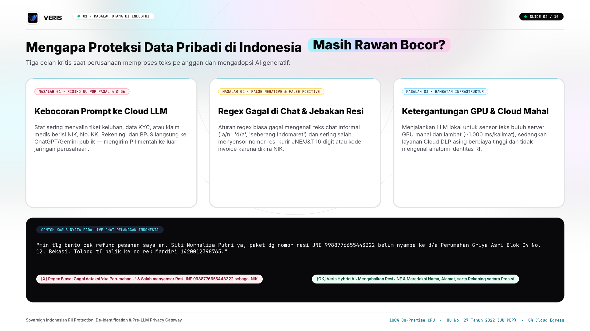

Organisasi di Indonesia (*Fintech*, Perbankan, *E-Commerce*, Logistik, Rumah Sakit, dan Instansi Pemerintah) menghadapi tiga celah kritis saat memproses teks pelanggan dan mengadopsi *Large Language Models* (LLM):

1. **Kebocoran Data pada Prompt AI Eksternal (*Shadow AI Leakage*):** Karyawan sering menyalin tiket keluhan pelanggan, berkas KYC, atau rekam medis yang memuat `NIK`, `NO_KK`, dan `NO_REKENING` langsung ke layanan LLM publik (ChatGPT, Claude, Gemini). Tindakan ini melanggar **Pasal 4 dan Pasal 56 UU PDP** terkait transfer data pribadi lintas batas tanpa pelindungan memadai.
2. **Kegagalan Regex pada Teks Chat & Tingginya *False Positive* pada Nomor Resi:**
   - Aturan *regex* konvensional gagal mengenali nama dan alamat tidak terstruktur pada chat informal (*"min tlg bantu refund an. Siti Nurhaliza ke d/a Perumahan Griya Asri..."*).
   - Sebaliknya, *regex* 16 digit biasa sering salah menyensor nomor resi kurir logistik (`JNE`/`J&T`), kode transaksi (`#TRX-...`), atau nomor *Virtual Account* sebagai `NIK`, sehingga merusak konteks bisnis.
3. **Biaya Infrastruktur GPU & Ketidakcocokan Cloud DLP Asing:** Menjalankan LLM lokal di dalam perusahaan membutuhkan server GPU berbiaya tinggi dan latensi ratusan hingga ribuan milidetik per kalimat, sementara layanan *Cloud DLP* komersial mengenakan biaya per karakter dan tidak memahami aturan spesifik dokumen kependudukan Indonesia.

### Komparasi Posisi Teknis Veris

| Dimensi Evaluasi | Regex / Rule-Based Konvensional | Cloud DLP / API Asing | Cloud LLM Prompting (Few-Shot) | **Veris Hybrid Engine (`S5_LocalCPU`)** |
| :--- | :---: | :---: | :---: | :---: |
| **Validasi Checksum Resmi RI (`NIK`, `KK`, `NPWP`, `BPJS`)** | Parsial / Tanpa Konteks | Tidak Mendukung | Halusinasi Digit | **100% Validasi Regulasi RI** |
| **Deteksi Nama & Alamat Informal (`a/n`, `d/a`, Patokan Lokal)** | Gagal (`Recall < 70%`) | Terbatas Bahasa Inggris | Akurat namun Lambat | **IndoBERT 21-BIO + Boundary Refiner** |
| **Imunitas Jebakan Nomor Resi / Invoice / Virtual Account** | Rawan *False Positive* | Rawan *False Positive* | Tidak Konsisten | **Context-Window Trap Filter** |
| **Pre-LLM Reversible Vault & Anti-Prompt Injection** | Tidak Ada | Tidak Ada | Tidak Ada | **Built-in (`/api/v1/gateway`)** |
| **Kebutuhan Infrastruktur GPU** | Tidak Perlu | Cloud Eksternal | Cloud Eksternal | **Tidak Perlu (100% CPU Standar)** |
| **Risiko Kebocoran Data ke Pihak Ketiga (*Cloud Egress*)** | `0%` | `100%` (Terkirim ke Cloud) | `100%` (Terkirim ke LLM) | **`0.0%` (100% Lokal & Stateless)** |

---

## 3. Tampilan Antarmuka Web (Veris Web Console)

Veris dilengkapi dengan antarmuka web berbasis **Next.js 14 (App Router)**, **TypeScript**, dan **Tailwind CSS** yang dirancang menggunakan tipografi `Inter` & `JetBrains Mono` serta palet *Light-First Pastel-Prismatic Aurora*.

### A. Landing Page & 3D Hybrid Pipeline Showcase (`/`)
Menampilkan visualisasi interaktif *real-time* bagaimana aliran teks mentah (*Raw Enterprise Stream*) diproses oleh **Veris Hybrid Engine** hingga menghasilkan teks terproteksi beserta status kepatuhan UU PDP.

<div align="center">
  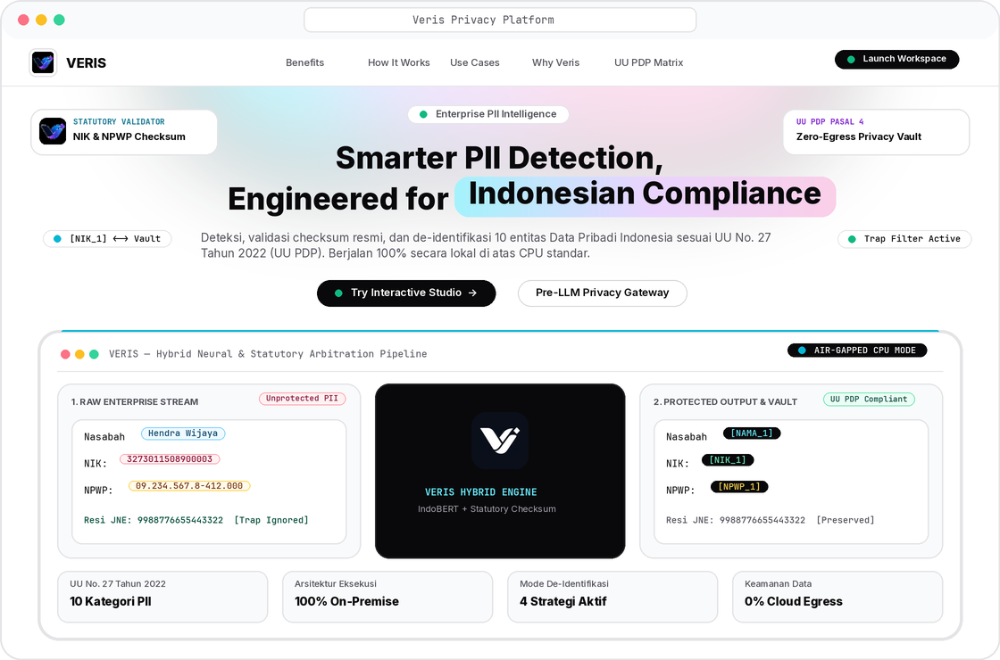
</div>

### B. PII Redaction & UU PDP Studio (`/workspace?tab=studio`)
Ruang kerja interaktif untuk tim *Data Protection Officer* (DPO), *Compliance*, dan * Data Engineer* dengan 3 *preset* industri (*Fintech*, *E-Commerce*, *Layanan Publik*), penyorot *span* PII berwarna, 4 pilihan mode redaksi instan (`Tag`, `Mask`, `SHA-256`, `Surrogate`), kalkulator skor risiko UU PDP, serta **Tabel Audit In-Memory Reversible Vault**.

<div align="center">
  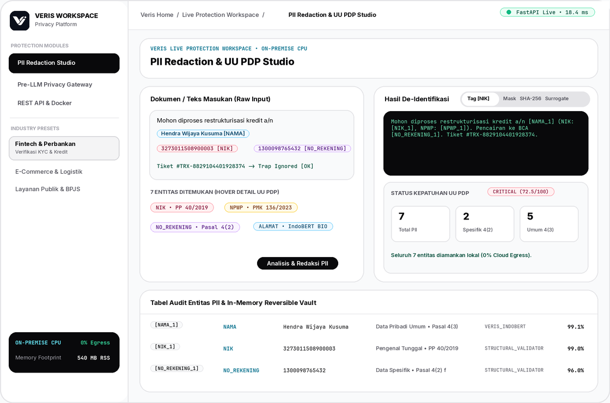
</div>

### C. Pre-LLM Privacy Gateway Simulator (`/workspace?tab=gateway`)
Memvisualisasikan 4 tahap intersepsi prompt sensitif sebelum dikirim ke Cloud LLM eksternal, memastikan LLM hanya memproses token anonim `[ENTITAS_N]` dan memulihkan identitas asli secara lokal di memori pengguna.

<div align="center">
  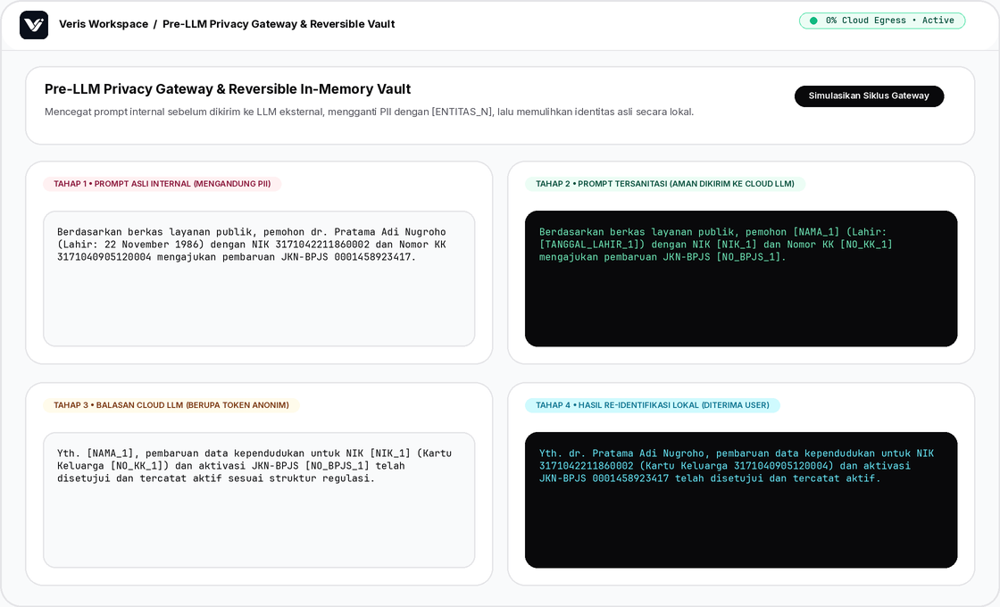
</div>

---

## 4. Arsitektur Sistem & Pipeline Hibrida 4-Tahap

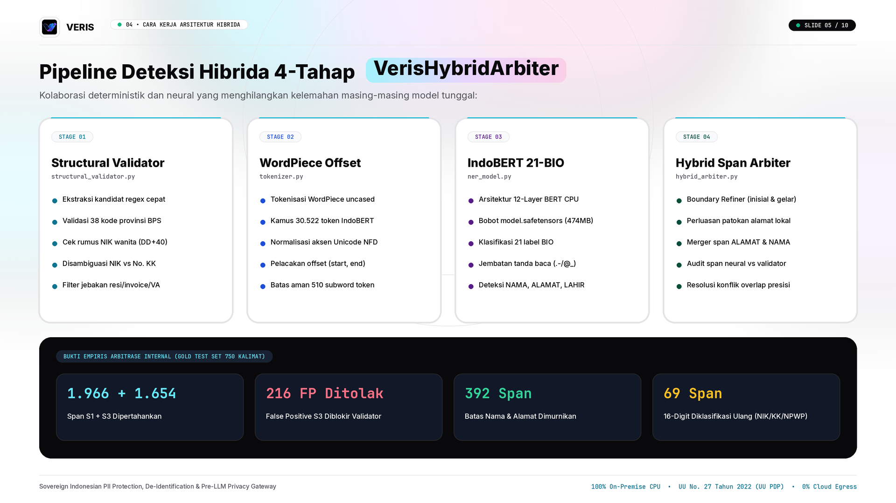

```mermaid
flowchart TB
    subgraph ClientLayer ["Lapisan Klien & Integrasi Enterprise"]
        Browser["Web Browser\n(DPO / Compliance / Engineer)"]
        InternalApp["Aplikasi Internal, CRM, Log Pipeline,\n& AI Chatbot Perusahaan"]
    end

    subgraph EdgeLayer ["Lapisan Edge & Reverse Proxy"]
        Nginx["Nginx Reverse Proxy (:80 / :443)\n• Terminasi TLS 1.2 / 1.3\n• Rate Limit Zone (10 req/s, burst 25)\n• Max Body 512 KB & IP ACL /docs"]
    end

    subgraph Appliance ["Veris On-Premise Docker Network (veris-net)"]
        FE["veris-frontend (:3000)\nNext.js 14.2 Standalone\n• Landing Showcase (/)\n• Protection Studio (/workspace)"]
        
        subgraph BackendContainer ["veris-backend (:8000) • Non-Root UID 10001 • Stateless RAM"]
            MW["VerisSecurityMiddleware\n• Sliding-Window Rate Limiter (120 rpm/IP)\n• Constant-Time X-Veris-API-Key (HMAC)\n• OWASP Headers & Cache-Control: no-store"]
            
            subgraph HybridEngine ["VerisHybridArbiter (4-Stage CPU Detection Pipeline)"]
                S1["Stage 1: StructuralValidatorDetector\n(Regex + Kode Wilayah BPS + DD+40 + Anti-Trap)"]
                S2["Stage 2: VerisWordPieceTokenizer\n(30.522 Vocab IndoBERT + Character Offset Mapping)"]
                S3["Stage 3: VerisIndoBERTDetector\n(12-Layer BERT CPU • 21 BIO Classes • safetensors)"]
                S4["Stage 4: Hybrid Span Arbiter & Boundary Refiner\n(Cross-Audit, Address Merger, Title/Initial Refiner)"]
                
                S1 --> S4
                S2 --> S3 --> S4
            end
            
            Redactor["VerisRedactionService & Privacy Gateway\n• 4 Mode: Tag, Mask, HMAC-SHA256, Surrogate\n• UU PDP Risk Scoring (Pasal 4 Ayat 2 & 3)\n• Prompt Injection & Anti-Tag Spoofing Guard\n• Ephemeral In-Memory Reversible Vault"]
            
            MW --> S1 & S2
            S4 --> Redactor
        end
    end

    Browser --> Nginx
    InternalApp --> Nginx
    Nginx -->|"/" & "/workspace"| FE
    Nginx -->|"/api/v1/*"| MW
    FE -->|"Internal Proxy Rewrite"| MW
```

👉 **Baca penjelasan teknis mendalam di [docs/ARCHITECTURE_OVERVIEW.md](docs/ARCHITECTURE_OVERVIEW.md).**

---

## 5. Cakupan 10 Entitas PII & Pemetaan Regulasi UU PDP

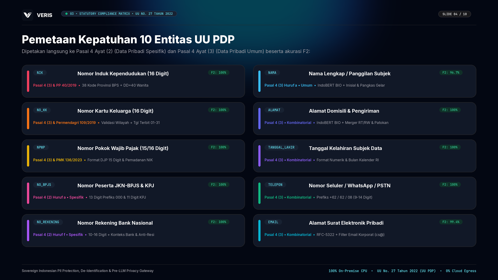

| Kode Entitas | Nama Entitas | Klasifikasi UU PDP | Dasar Hukum & Regulasi Teknis | Aturan Validasi & Deteksi pada Veris | Bobot Risiko |
| :--- | :--- | :--- | :--- | :--- | :---: |
| **`NIK`** | Nomor Induk Kependudukan | Pengenal Kritis / Tunggal | UU PDP Pasal 4 (3) & **PP No. 40 Tahun 2019 Pasal 31–32** | 16 digit, 38 kode provinsi BPS (`11–96`), kode kab/kota & kecamatan (`!= 00`), `DD` (`01–31` pria / `41–71` wanita `+40`), `MM` (`01–12`), `SSSS != 0000`. | `30.0` (`CRITICAL`) |
| **`NO_KK`** | Nomor Kartu Keluarga | Pengenal Kritis Keluarga | UU PDP Pasal 4 (3) & **Permendagri No. 109 Tahun 2019** | 16 digit, validasi kode wilayah 6 digit + tanggal penerbitan KK (`DD` `01–31`, `MM` `01–12`) + disambiguasi konteks `"kk"` / `"kartu keluarga"`. | `28.0` (`CRITICAL`) |
| **`NPWP`** | Nomor Pokok Wajib Pajak | Data Keuangan / Pajak | UU PDP Pasal 4 (3) & **PMK No. 136 Tahun 2023** | Mendukung format 15 digit lama (`99.999.999.9-999.999` dengan *taxpayer type* `01–09` & kode KPP `!= 000`) serta NPWP 16 digit hasil pemadanan NIK. | `28.0` (`CRITICAL`) |
| **`NO_BPJS`** | Nomor JKN-BPJS & KPJ | **Data Pribadi Spesifik** (Kesehatan) | **UU PDP Pasal 4 Ayat (2) Huruf a** & PerBPJS No. 6/2018 | 13 digit dengan prefiks wajib `000` (JKN-BPJS Kesehatan) atau 11 digit dengan konteks eksplisit `"bpjs"` / `"jkn"` / `"kis"` / `"kpj"` (BPJS Ketenagakerjaan). | `26.0` (`CRITICAL`) |
| **`NO_REKENING`** | Nomor Rekening Bank Nasional | **Data Pribadi Spesifik** (Data Keuangan) | **UU PDP Pasal 4 Ayat (2) Huruf f** | 10–16 digit yang wajib didampingi konteks perbankan (`"rekening"`, `"no rek"`, `"bca"`, `"mandiri"`, `"bri"`, `"bni"`, `"bsi"`, `"cimb"`, dll.) & bebas konteks resi. | `26.0` (`CRITICAL`) |
| **`NAMA`** | Nama Lengkap / Panggilan | Data Pribadi Umum | UU PDP Pasal 4 Ayat (3) Huruf a | Deteksi sekuens `B-NAMA` / `I-NAMA` oleh *Fine-Tuned IndoBERT* + ekspansi inisial (`H.`, `M.`, `Abd.`) + pemangkasan gelar/honorifik dan kata kerja. | `16.0` (`HIGH`) |
| **`ALAMAT`** | Alamat Domisili & Pengiriman | Data Pribadi Umum (Kombinatorial) | UU PDP Pasal 4 Ayat (3) | Deteksi sekuens `B-ALAMAT` / `I-ALAMAT` oleh *Fine-Tuned IndoBERT* + *Address Span Merger* (menyatukan jalan, gang, blok, RT/RW, kelurahan, kode pos, & patokan). | `16.0` (`HIGH`) |
| **`TANGGAL_LAHIR`** | Tanggal Kelahiran Subjek | Data Pribadi Umum (Kombinatorial) | UU PDP Pasal 4 Ayat (3) | *Hybrid* IndoBERT + *Regex* tanggal numerik (`DD/MM/YYYY`, `YYYY-MM-DD`) & bulan kalender Bahasa Indonesia (`Januari`–`Desember`) dengan konteks kelahiran/TTL. | `14.0` (`HIGH`) |
| **`TELEPON`** | Nomor Seluler / WhatsApp / PSTN | Data Pribadi Umum (Kombinatorial) | UU PDP Pasal 4 Ayat (3) | Format telekomunikasi Indonesia (`+62`, `62`, `08xx`, atau kode area PSTN `021`/`022`/`031`) dengan panjang bersih 9–14 digit. | `12.0` (`MEDIUM`) |
| **`EMAIL`** | Alamat Surat Elektronik Pribadi | Data Pribadi Umum (Kombinatorial) | UU PDP Pasal 4 Ayat (3) | Standar RFC-5322 dengan **Filter Role-Email Korporat** otomatis yang mengabaikan alamat fungsional non-pribadi (`cs@`, `admin@`, `support@`, `info@`, `hrd@`, `noreply@`). | `12.0` (`MEDIUM`) |

---

## 6. Benchmark Empiris & Evaluasi Ilmiah

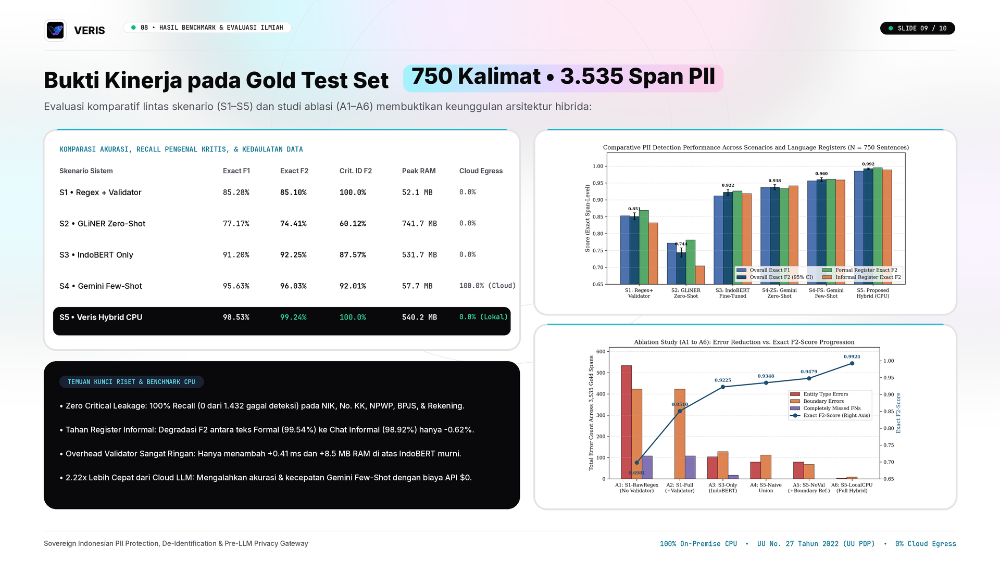

Arsitektur Veris diuji pada **Gold Test Set** berjumlah **$750$ kalimat ($3.535$ span PII)** lintas sektor (*Fintech*, *E-Commerce*, *GovTech/Kesehatan*) dan register bahasa (*Formal* vs. *Informal Live Chat*):

| Skenario Evaluasi | Exact Precision | Exact Recall | Exact $F_1$ | **Exact $F_2$** | $F_2$ Formal | $F_2$ Informal | **Critical ID Recall** | Latensi Mean (CPU) | Peak RAM (RSS) | Cloud Egress |
| :--- | :---: | :---: | :---: | :---: | :---: | :---: | :---: | :---: | :---: | :---: |
| **`S1_Regex`** *(Regex + Validator)* | `86.02%` | `84.56%` | `85.28%` | `85.10%` | `86.80%` | `83.02%` | **`100.00%`** | `0.21 ms` | `52.1 MB` | `0.0%` |
| **`S2_GLiNER`** *(Zero-Shot Multilingual)* | `90.61%` | `67.20%` | `77.17%` | `74.41%` | `77.59%` | `70.50%` | `60.12%` | `134.80 ms` | `741.7 MB` | `0.0%` |
| **`S3_IndoBERT`** *(Fine-Tuned Neural Murni)* | `86.30%` | `96.68%` | `91.20%` | `92.25%` | `92.46%` | `91.99%` | `87.57%` | `479.88 ms` | `531.7 MB` | `0.0%` |
| **`S4-ZS_Gemini`** *(Cloud LLM Zero-Shot)* | `93.36%` | `93.62%` | `93.49%` | `93.51%` | `93.12%` | `94.00%` | `91.61%` | `812.40 ms` | `56.8 MB` | `100.0%` |
| **`S4-FS_Gemini`** *(Cloud LLM 5-Shot)* | `94.07%` | `97.24%` | `95.63%` | `96.03%` | `96.09%` | `95.95%` | `92.01%` | `1.064.20 ms` | `57.7 MB` | `100.0%` |
| **`S5_LocalCPU` (Veris Hybrid Engine)** | **`97.38%`** | **`99.72%`** | **`98.53%`** | **`99.24%`** | **`99.54%`** | **`98.92%`** | **`100.00%`** | **`480.29 ms`** | **`540.2 MB`** | **`0.0%`** |

<p align="center">
  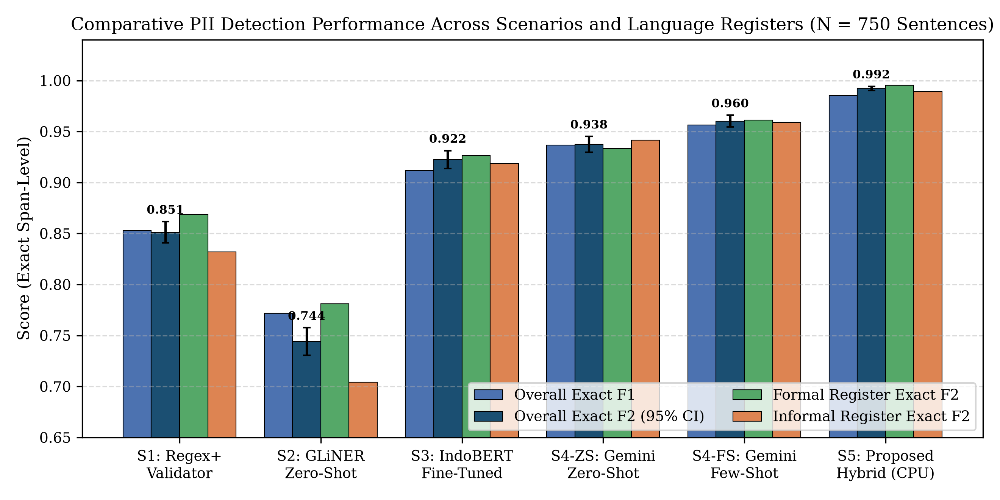
  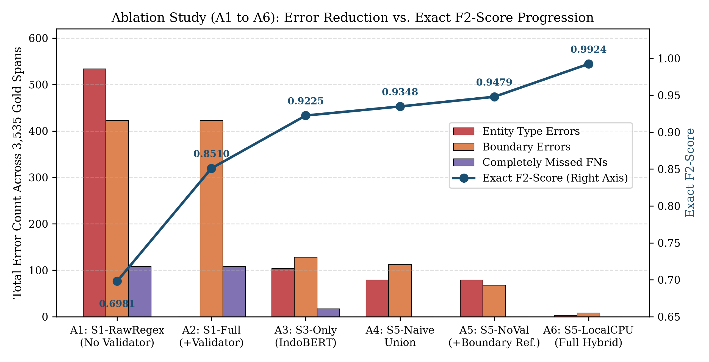
</p>

👉 **Lihat laporan lengkap, heatmap per entitas, dan grafik Pareto di [docs/BENCHMARK_REPORT.md](docs/BENCHMARK_REPORT.md).**

---

## 7. Empat Strategi De-Identifikasi

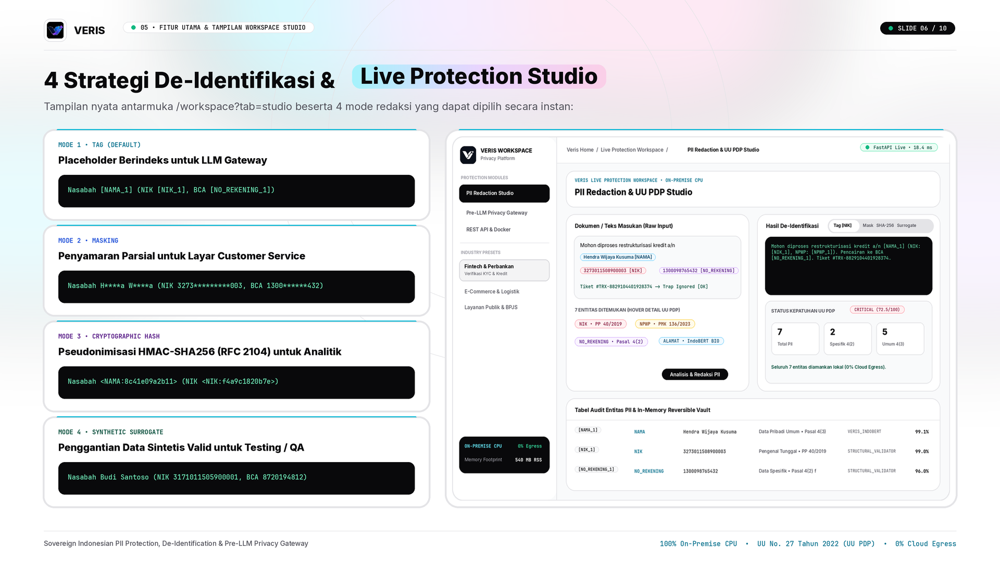

| Mode | Kode API | Contoh Keluaran (`redacted_text`) | Kegunaan Utama | Reversible? |
| :--- | :---: | :--- | :--- | :---: |
| **1. Entity Tagging** *(Default)* | `"tag"` | `Nasabah [NAMA_1] (NIK [NIK_1], BCA [NO_REKENING_1])` | Sanitasi prompt untuk **Pre-LLM Privacy Gateway** & pemulihan identitas lokal (*Reversible Vault*). | **Ya** (via `vault_mapping` di RAM) |
| **2. Partial Masking** | `"mask"` | `Nasabah H****a W****a (NIK 3273*********003, BCA 1300******432)` | Penampilan data aman di layar agen *Customer Service* atau *dashboard* operasional. | Tidak (Satu Arah) |
| **3. Cryptographic Hash** | `"hash"` | `Nasabah <NAMA:8c41e09a2b11> (NIK <NIK:f4a9c1820b7e>)` | Pseudonimisasi deterministik berbasis **RFC 2104 `HMAC-SHA256`** (12 karakter heksadesimal) untuk *Data Warehouse* & analitik lintas tabel tanpa membuka nilai asli. | Tidak (Satu Arah, Deterministik) |
| **4. Synthetic Surrogate** | `"surrogate"` | `Nasabah Budi Santoso (NIK 3171011505900001, BCA 8720194812)` | Penggantian PII dengan data sintetis Bahasa Indonesia yang tampak alami untuk lingkungan *Staging*, *Testing/QA*, atau pelatihan model AI. | Tidak (Satu Arah) |

---

## 8. Pre-LLM Privacy Gateway & AI Security Guardrail

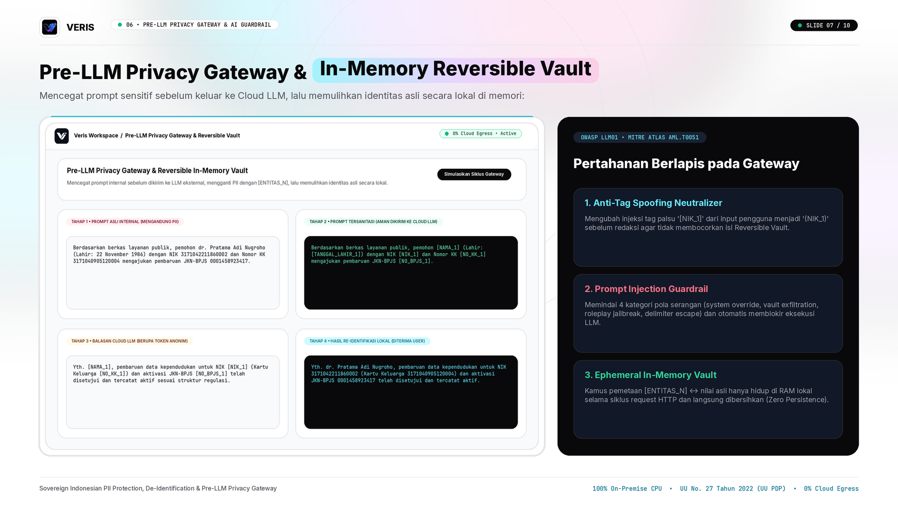

Modul **Pre-LLM Privacy Gateway (`/api/v1/gateway`)** memungkinkan perusahaan memanfaatkan kecerdasan LLM eksternal (OpenAI, Gemini, Claude, dll.) **tanpa pernah mengirim satu pun data pribadi asli ke luar jaringan internal**, dilengkapi dengan 3 lapis pertahanan keamanan AI:

1. **Anti-Tag Spoofing Neutralizer:** Mengubah injeksi tag palsu `[NIK_1]` dari input pengguna menjadi `(NIK_1)` sebelum redaksi agar tidak dapat memanipulasi atau membocorkan isi *Reversible Vault*.
2. **Prompt Injection Guardrail (*OWASP LLM01 / MITRE ATLAS AML.T0051*):** Memindai 4 kategori pola serangan (*system override*, *vault exfiltration*, *roleplay jailbreak*, *delimiter escape*) dan otomatis memblokir penerusan ke LLM apabila terdeteksi ancaman.
3. **Ephemeral Request-Scoped Vault:** Kamus `vault_mapping` hanya berada di RAM lokal selama siklus permintaan HTTP berlangsung dan langsung dihapus (*Zero Persistence*).

---

## 9. Referensi REST API (`v1`)

| Metode | Endpoint | Deskripsi Fungsional | Batas Input |
| :---: | :--- | :--- | :---: |
| `GET` | `/api/v1/health` | Status kesiapan mesin (`healthy`), status model neural (`indobert_loaded`), mode `ON_PREMISE_CPU`, penggunaan RAM (`memory_rss_mb`), dan `cloud_egress_percent: 0.0`. | — |
| `GET` | `/api/v1/taxonomy` | Kamus 10 entitas PII beserta kategori UU PDP, referensi pasal, deskripsi aturan, dan bobot risiko. | — |
| `POST` | `/api/v1/detect` | Deteksi span PII beserta koordinat karakter `(start, end)`, *confidence score*, sumber detektor, dan skor risiko UU PDP. | `1 – 50.000` karakter |
| `POST` | `/api/v1/redact` | De-identifikasi teks menggunakan salah satu dari 4 mode (`tag`, `mask`, `hash`, `surrogate`) dan mengembalikan `redacted_text` beserta `vault_mapping`. | `1 – 50.000` karakter |
| `POST` | `/api/v1/batch-redact` | De-identifikasi massal terhadap sekumpulan dokumen sekaligus dalam satu panggilan API. | Maks. `100` dokumen |
| `POST` | `/api/v1/gateway` | Siklus penuh **Pre-LLM Privacy Gateway**: sanitasi keluar, pemindaian *Prompt Injection*, simulasi balasan LLM, dan re-identifikasi lokal melalui *Reversible Vault*. | `1 – 25.000` karakter |

👉 **Lihat contoh *payload* JSON lengkap di [docs/API_SPECIFICATION.md](docs/API_SPECIFICATION.md).**

---

## 10. Skenario Implementasi Enterprise

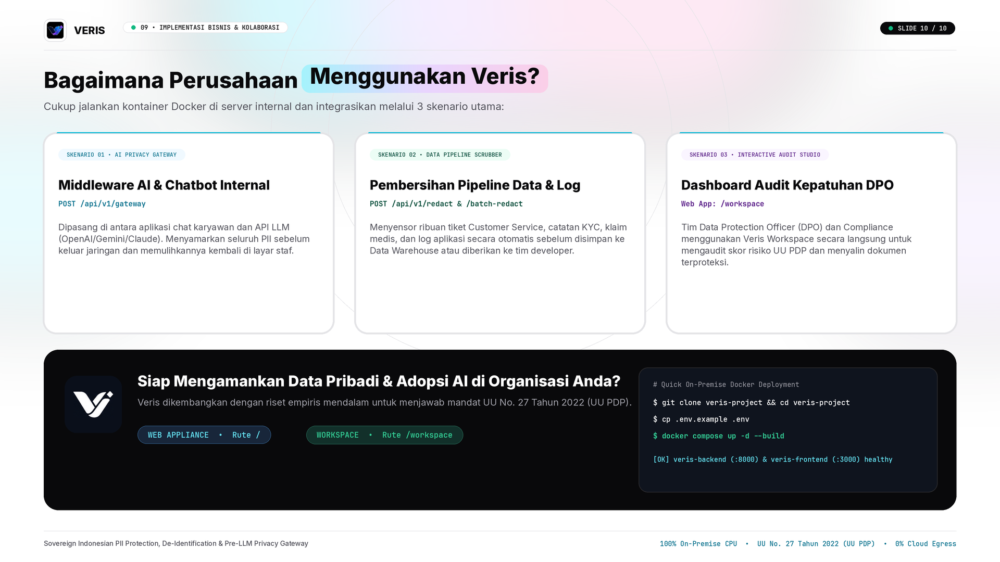

1. **Middleware AI & Chatbot Internal (`POST /api/v1/gateway`):** Dipasang di antara aplikasi *chat* karyawan dan API Cloud LLM untuk menyamarkan seluruh PII sebelum keluar jaringan dan memulihkannya kembali di layar pengguna.
2. **Pembersihan Pipeline Data & Log (`POST /api/v1/redact` & `/batch-redact`):** Menyensor ribuan tiket *Customer Service*, catatan KYC, klaim medis, dan *log* aplikasi secara otomatis sebelum disimpan ke *Data Warehouse* atau diberikan ke tim *developer*.
3. **Dashboard Audit Kepatuhan DPO (`/workspace`):** Digunakan oleh tim *Data Protection Officer* (DPO) dan *Compliance* untuk mengaudit skor risiko UU PDP pada dokumen perusahaan secara instan.

---

## Struktur Repositori Showcase

```text
veris-uupdp-showcase/
├── assets/
│   ├── figures/                              # Grafik hasil evaluasi ilmiah & studi ablasi (300 DPI)
│   ├── logo/                                 # Aset identitas visual Veris
│   └── ui/                                   # Tangkapan layar antarmuka Landing Page & Workspace Studio
├── docs/
│   ├── ARCHITECTURE_OVERVIEW.md              # Dokumentasi teknis pipeline hibrida 4-tahap & security hardening
│   ├── API_SPECIFICATION.md                  # Spesifikasi kontrak REST API v1 & contoh payload JSON
│   └── BENCHMARK_REPORT.md                   # Laporan pengujian komparatif S1-S5 & studi ablasi A1-A6
├── slides/                                   # 10 slide presentasi eksekutif resolusi tinggi (1920 x 1080 px)
├── LICENSE                                   # Ketentuan Hak Cipta & Perlindungan Kekayaan Intelektual
└── README.md                                 # Halaman utama dokumentasi showcase
```

---

<div align="center">

**VERIS — Sovereign On-Premise Indonesian PII Detection, Statutory De-Identification & Pre-LLM Privacy Gateway**  
*Copyright © 2026 Salsabila Putri. All Rights Reserved.*

</div>
