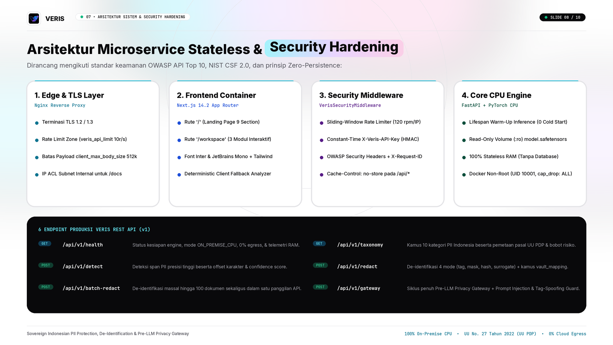
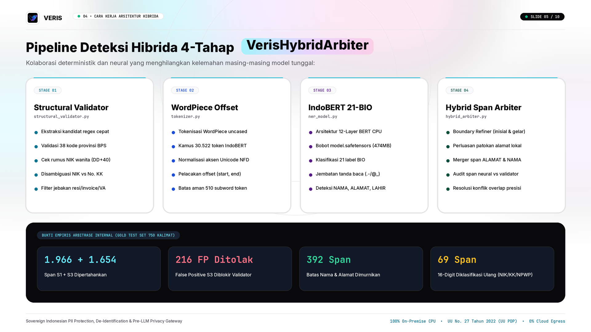

# Arsitektur Teknis Veris Hybrid PII Engine

> **Dokumen Spesifikasi Arsitektur — Veris v1.0.0**  
> **Fokus Kepatuhan:** Undang-Undang Nomor 27 Tahun 2022 tentang Pelindungan Data Pribadi (UU PDP)

---

## 1. Filosofi Desain

**Veris** dirancang dengan prinsip **Zero Cloud Egress** dan **CPU-First Sovereign Execution**. Seluruh proses deteksi, validasi regulasi, de-identifikasi 4 mode, dan pemulihan token (*Reversible Vault*) berjalan **100% di dalam memori lokal (RAM)** tanpa ketergantungan pada GPU maupun penyimpanan *database* permanen (*Zero Disk Persistence*).

---

## 2. Pipeline Deteksi Hibrida 4-Tahap (`VerisHybridArbiter`)

Pendekatan tunggal (*rule-based* murni atau *deep learning* murni) memiliki kelemahan struktural saat dihadapkan pada dokumen bisnis Indonesia:
- **Kelemahan Regex Murni:** Gagal mendeteksi entitas bebas seperti `NAMA` dan `ALAMAT` pada percakapan tidak baku, serta sering menghasilkan *false positive* pada deretan 16 digit non-PII (nomor resi JNE/J&T, *invoice*, *Virtual Account*).
- **Kelemahan Neural NER Murni:** Rawan meloloskan digit pengenal kritis atau salah memberi label `NIK` pada nomor resi logistik karena kemiripan pola angka.

**Veris** menyelesaikan masalah ini melalui kolaborasi 4 tahap di dalam `VerisHybridArbiter`:

### Tahap 1 — `StructuralValidatorDetector`
Mengekstrak dan memvalidasi kandidat pengenal terstruktur berdasarkan regulasi resmi Republik Indonesia:
- **`NIK` (PP No. 40 Tahun 2019 Pasal 31–32):** Memverifikasi 16 digit yang terdiri atas 38 kode provinsi sah BPS/Kemendagri (`11` s.d. `96`), kode kabupaten/kota (`!= 00`), kode kecamatan (`!= 00`), tanggal lahir `DD` (`01–31` untuk laki-laki dan `41–71` hasil penambahan `+40` untuk perempuan), bulan `MM` (`01–12`), serta nomor urut `SSSS != 0000`.
- **`NO_KK` (Permendagri No. 109 Tahun 2019):** Memvalidasi struktur 6 digit wilayah dan 6 digit tanggal penerbitan Kartu Keluarga (`DD` `01–31`, `MM` `01–12`) yang didampingi petunjuk konteks eksplisit (`"kk"`, `"no kk"`, `"kartu keluarga"`).
- **`NPWP` (PMK No. 136 Tahun 2023):** Mendukung format 15 digit (`XX.XXX.XXX.X-XXX.XXX` dengan kode jenis wajib pajak `01–09` dan kode KPP `!= 000`) serta format 16 digit pemadanan NIK.
- **`NO_BPJS` (UU PDP Pasal 4 Ayat 2 Huruf a):** Memvalidasi 13 digit kepesertaan JKN-BPJS Kesehatan berprefiks `000` atau 11 digit BPJS Ketenagakerjaan (`KPJ`).
- **`NO_REKENING` (UU PDP Pasal 4 Ayat 2 Huruf f):** Memvalidasi nomor rekening 10–16 digit yang berada di dalam jendela konteks (`±60` karakter) nama bank nasional (`BCA`, `Mandiri`, `BRI`, `BNI`, `BSI`, `CIMB`, `Permata`, `BTN`, `Danamon`, dll.) atau kata kunci transaksi perbankan.
- **Hard-Negative Trap Filter (`is_dominated_by_trap_cue`):** Menghitung jarak karakter terdekat antara kata kunci positif dan kata kunci jebakan (`resi`, `awb`, `waybill`, `jne`, `j&t`, `sicepat`, `invoice`, `inv`, `order`, `tiket`, `trx`, `va`, `virtual account`, `kode bayar`). Jika konteks jebakan lebih dekat daripada konteks PII, kandidat langsung ditolak.

### Tahap 2 — `VerisWordPieceTokenizer`
Melakukan tokenisasi *WordPiece uncased* menggunakan kamus `vocab.txt` IndoBERT (`30.522` token) sambil melacak indeks karakter asli `(start_char, end_char)` dari setiap sub-kata hingga batas `510` token (`max_length = 512`).

### Tahap 3 — `VerisIndoBERTDetector`
Menjalankan inferensi `BertForTokenClassification` (12 *layer*, `hidden_size = 768`, 21 label `BIO`) langsung dari file `model.safetensors` di atas CPU menggunakan `torch.inference_mode()`. Dilengkapi *punctuation bridge* untuk menyatukan rentang entitas yang dipisahkan tanda baca internal.

### Tahap 4 — `Hybrid Span Arbiter` & `Contextual Boundary Refiner`
- **Veto & Audit Silang Validator:** Prediksi neural pada kategori terstruktur (`NIK`, `NO_KK`, `NPWP`, `NO_BPJS`, `NO_REKENING`, `TELEPON`, `EMAIL`) yang gagal melewati pemeriksaan validator struktural atau berada di area *trap cue* otomatis dibatalkan (menolak **216 *False Positive*** pada pengujian *Gold Test Set*).
- **Disambiguasi 16 Digit:** Mengoreksi label 16 digit yang tertukar antara `NIK`, `NO_KK`, dan `NPWP` berdasarkan petunjuk konteks terdekat (**69 span** berhasil diklasifikasi ulang secara tepat).
- **Pemurnian Batas Nama & Alamat (`BoundaryRefiner`):** Memangkas kata depan/sapaan (`"Bapak"`, `"Ibu"`, `"dr."`, `"a/n"`, `"an."`), menangkap inisial nama di depan (`"M. Fadli"`, `"H. Agus"`), serta menggabungkan fragmen alamat yang terpisah oleh `RT/RW`, `Blok`, `Kelurahan`, `Kecamatan`, `Kode Pos`, dan patokan lokasi lokal (**392 span** berhasil dimurnikan).

---

## 3. Pertahanan Keamanan Berlapis (*Security Hardening*)

1. **`VerisSecurityMiddleware`:**
   - **Sliding-Window Rate Limiter:** Membatasi laju permintaan per IP (default `120 req/menit`) menggunakan *thread-safe deque*.
   - **Payload Size Guard:** Menolak *request body* yang melebihi `512 KB` (`HTTP 413`) sebelum diproses ke memori.
   - **Constant-Time API Key Verification:** Mendukung autentikasi `X-Veris-API-Key` atau `Authorization: Bearer` menggunakan `hmac.compare_digest` untuk mencegah *timing attack*.
   - **OWASP HTTP Response Headers:** Menyematkan `X-Content-Type-Options: nosniff`, `X-Frame-Options: DENY`, `Referrer-Policy: no-referrer`, `Permissions-Policy`, `Cache-Control: no-store`, dan `X-Request-ID` unik pada setiap respons.
2. **Hardened Non-Root Docker Containers:**
   - Dijalankan menggunakan pengguna non-root (`UID 10001`), pencabutan seluruh kapabilitas kernel Linux (`cap_drop: ALL`), serta `security_opt: no-new-privileges:true`.
