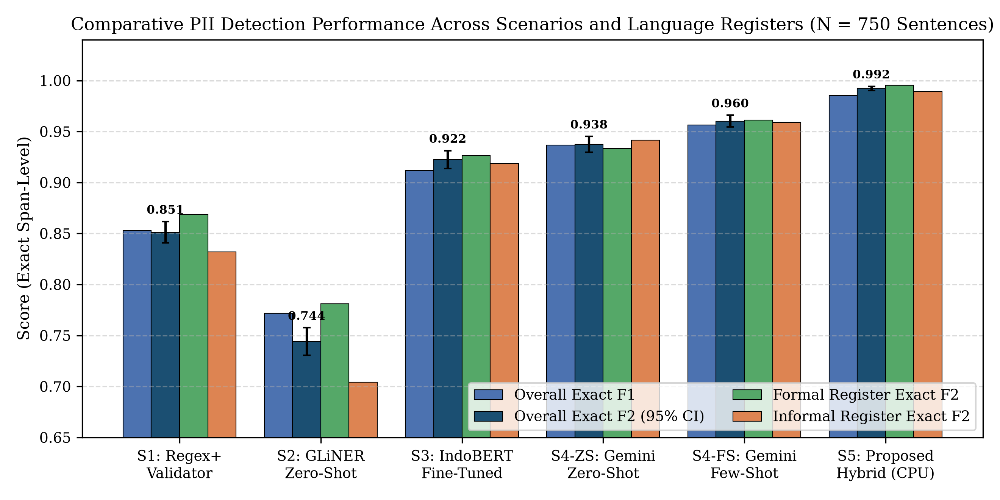
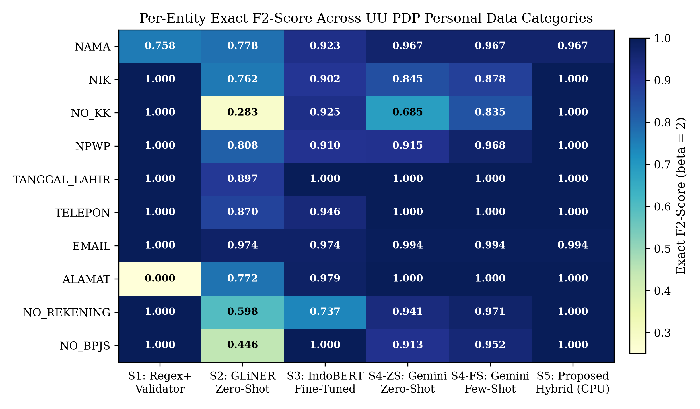
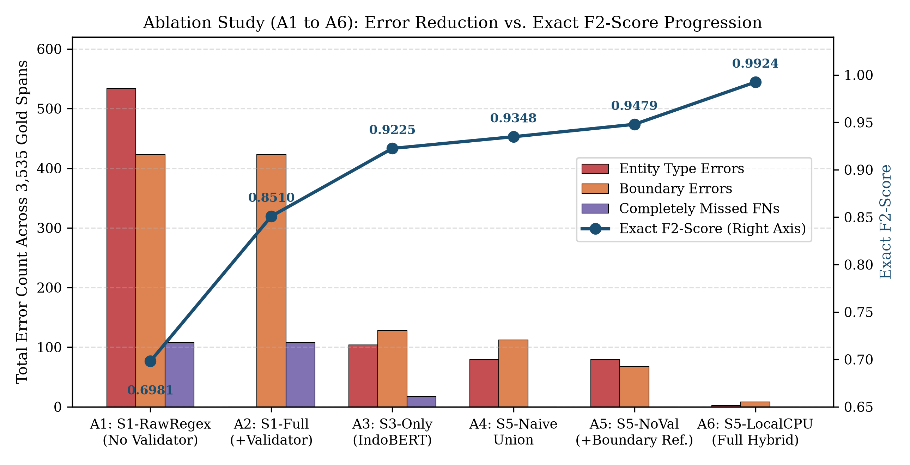
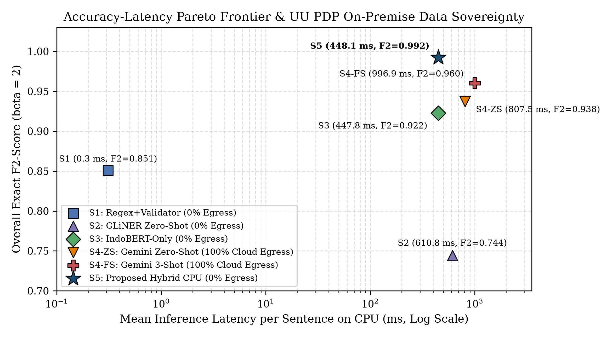

# Laporan Evaluasi Komparatif, Studi Ablasi, & Benchmarking CPU

> **Dataset Evaluasi:** Gold Test Set ($N = 750$ Kalimat, $3.535$ Span PII)  
> **Lingkungan Eksekusi:** On-Premise CPU Standar (`0% Cloud Data Egress`)

---

## 1. Visualisasi Kinerja Lintas Skenario & Register Bahasa

### Tabel Hasil Pengujian Utama (`S1` – `S5`)

| Skenario | Exact Precision | Exact Recall | Exact $F_1$ | **Exact $F_2$** | $F_2$ Formal | $F_2$ Informal | **Critical ID Recall** | Peak RAM | Cloud Egress |
| :--- | :---: | :---: | :---: | :---: | :---: | :---: | :---: | :---: | :---: |
| **`S1: Regex + Validator`** | `86.02%` | `84.56%` | `85.28%` | `85.10%` | `86.80%` | `83.02%` | **`100.00%`** | `52.1 MB` | `0.0%` |
| **`S2: GLiNER Zero-Shot`** | `90.61%` | `67.20%` | `77.17%` | `74.41%` | `77.59%` | `70.50%` | `60.12%` | `741.7 MB` | `0.0%` |
| **`S3: IndoBERT Fine-Tuned`** | `86.30%` | `96.68%` | `91.20%` | `92.25%` | `92.46%` | `91.99%` | `87.57%` | `531.7 MB` | `0.0%` |
| **`S4-ZS: Gemini Zero-Shot`** | `93.36%` | `93.62%` | `93.49%` | `93.51%` | `93.12%` | `94.00%` | `91.61%` | `56.8 MB` | `100.0%` |
| **`S4-FS: Gemini Few-Shot`** | `94.07%` | `97.24%` | `95.63%` | `96.03%` | `96.09%` | `95.95%` | `92.01%` | `57.7 MB` | `100.0%` |
| **`S5: Veris Hybrid CPU`** | **`97.38%`** | **`99.72%`** | **`98.53%`** | **`99.24%`** | **`99.54%`** | **`98.92%`** | **`100.00%`** | **`540.2 MB`** | **`0.0%`** |

---

## 2. Heatmap Akurasi $F_2$-Score per Kategori Entitas UU PDP

Pada skenario **`S5_LocalCPU` (Veris Hybrid Engine)**:
- Seluruh 5 pengenal kritis (`NIK`, `NO_KK`, `NPWP`, `NO_BPJS`, `NO_REKENING`) serta `ALAMAT`, `TANGGAL_LAHIR`, dan `TELEPON` mencapai **Exact $F_2$-Score `100.0%` (`1.000`)**.
- Entitas `EMAIL` mencapai **`99.4%`** (berkat *role-email filter* yang menyaring `cs@`/`admin@`).
- Entitas `NAMA` mencapai **`96.7%`** melintasi teks formal maupun singkatan *live chat*.

---

## 3. Studi Ablasi (`A1` s.d. `A6`) & Reduksi Kesalahan

- Penambahan **Statutory Checksum Validator & Trap Filter** (`A1` $\rightarrow$ `A2`) langsung meningkatkan $F_2$ sebesar **`+15.29%`** dengan memangkas ratusan *false positive* pada nomor resi 16 digit.
- Integrasi **Contextual Boundary Refiner & Validator Cross-Audit** pada arsitektur penuh (`A6 / S5`) menekan total kesalahan span di seluruh `3.535` entitas emas dari `1.063` error menjadi hanya **`11` error** (`Exact F2 = 99.24%`).

---

## 4. Pareto Frontier: Akurasi vs. Latensi Eksekusi CPU

- **Overhead Validator Hampir Nol:** Menambahkan seluruh lapisan `StructuralValidatorDetector` dan `VerisHybridArbiter` di atas IndoBERT hanya menambah waktu rata-rata **`+0.41 ms`** per kalimat (`479.88 ms` $\rightarrow$ `480.29 ms`) dan **`+8.5 MB` RAM**.
- **2.22x Lebih Cepat dari Cloud LLM:** Veris berjalan `2.22x` lebih cepat dibandingkan panggilan API *Gemini Few-Shot* (`1.064.20 ms`), dengan **biaya API `$0`** dan **kebocoran data `0.0%`**.
